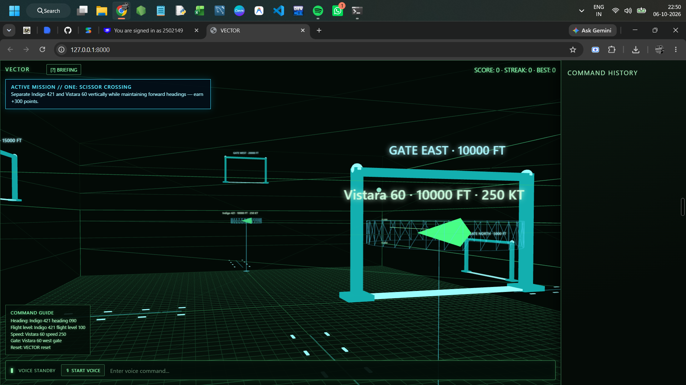

# ✈️ VECTOR: Tactical Air Combat (built by voice with Wispr Flow)

**VECTOR** is a browser-based **3D tactical air-combat prototype** powered by a **Python FastAPI** backend and a **Three.js** front end. Pick your jet (F-35 or Su-57) and a theatre, launch a round, then intercept hostile aircraft and neutralise fictional enemy sites while keeping your aircraft alive.

The project was **built using voice dictation** with [Wispr Flow](https://ref.wisprflow.ai/hhg): the code was spoken, not typed. It started life as **VECTOR ATC**, a voice-controlled air-traffic-control radar simulator, and has since evolved into this combat prototype.


<p align="center">
  
</p>
<p align="center"><sub>Screenshot from the earlier VECTOR ATC build.</sub></p>

---

## ✨ Features

- **Two jets** with different handling and loadouts
  - **Lockheed Martin F-35:** stealth multirole (speed 1.25 · turn 1.18 · 5 weapons)
  - **Sukhoi Su-57:** air-superiority multirole (speed 1.38 · turn 1.30 · 6 weapons)
- **Three theatres**, each with its own terrain, sky, fog and objective set
  - **Caucasus:** mountain frontier
  - **Persian Gulf:** desert coast / carrier approach
  - **Black Sea & Georgia:** coastal mountains / maritime
- **Objective-driven rounds:** intercept 5 hostile aircraft, protect a friendly asset, destroy 3 hostile sites, with live progress text
- **Real-time battlefield:** an async server loop (every 80 ms) moves your jet and the hostiles; flying too close to enemies triggers missile warnings and damage
- **HUD:** score, round, health, ammo, current objective and status messages
- **Weapons:** each shot uses 10% ammo; targets within range take damage (**+250** per kill, **+1000** for winning the round)
- **Victory screen** with a "Fly Again" button
- **3D scene in Three.js:** terrain, shadows, animated aircraft, exhaust, plus crew cards for the pilot **KAI**, the WSO **NOVA** and the squadron cat **JET** 🐈

---

## 🎮 Controls

| Input | Action |
| --- | --- |
| `←` / `→` or ◀ LEFT / RIGHT ▶ | Turn |
| `↑` / `↓` or ▲ CLIMB / ▼ DIVE | Climb / dive |
| `Space` or **FIRE WEAPON** | Fire at the nearest target |
| **F-35 / SU-57** | Select jet |
| **CAUCASUS / PERSIAN GULF / BLACK SEA** | Select theatre |
| **LAUNCH ROUND** | Start a new round |

---

## 🚀 Getting Started

**Requirements:** Python 3.11+ and an internet connection (Three.js loads from a CDN).

```bash
# 1. Clone this branch of the repository
git clone -b vector-atc https://github.com/somyaranjansahoo6422/Game-using-Wispr-Flow.git
cd Game-using-Wispr-Flow

# 2. Create and activate a virtual environment (recommended)
python -m venv venv
venv\Scripts\activate          # Windows
# source venv/bin/activate     # macOS / Linux

# 3. Install dependencies
pip install -r requirements.txt

# 4. Run the server
uvicorn app:app --reload --host 127.0.0.1 --port 8000
```

Then open **http://127.0.0.1:8000** in your browser.

---

## 🧱 Architecture

```
Browser (Three.js scene + HUD)  ──GET /api/state──▶  FastAPI (app.py)
            ▲                    ──POST /api/command─▶  • game state (jet, theatre, enemies, bases)
            └──────── JSON ◀─────────────────────────   • async game loop (80 ms tick)
                                                        • command handler (select / launch / maneuver / fire / reset)
```

| Endpoint | Method | Purpose |
| --- | --- | --- |
| `/` | GET | Serves the single-page 3D game |
| `/api/state` | GET | Full game state, jet info, theatre info, objective and progress |
| `/api/command` | POST | `{ "action": "select_jet" \| "select_theater" \| "launch" \| "maneuver" \| "fire" \| "reset", "value": "..." }` |

---

## 🎙️ Built by Voice

Every part of VECTOR was dictated using **Wispr Flow** push-to-talk; the keyboard was reserved for `Enter`, `Tab` and navigation. See [`RUN_SHEET.md`](RUN_SHEET.md) for the recording plan and spoken build prompts.

---

## 📂 Project Structure

```
Game-using-Wispr-Flow/  (branch vector-atc)
├── app.py            # FastAPI backend + embedded HTML/JS front end
├── requirements.txt  # fastapi, uvicorn
├── RUN_SHEET.md      # voice-build recording run sheet
├── demo.png          # screenshot (earlier ATC build)
└── briefing.png      # screenshot (earlier ATC build)
```

---

## 🔮 Roadmap

- Drop-in high-fidelity GLB models for jets and maps (`static/assets/jets/*.glb`, `static/assets/maps/*.glb`)
- Voice commands for flight and weapons
- Enemy AI that pursues and evades
- Multiple rounds with rising difficulty

---

## ⚠️ Disclaimer

All locations, targets and scenarios are **fictional** and intended purely for entertainment; this is not a real-world combat or flight model.

---

## 👤 Author

**Somya Ranjan Sahoo** · [GitHub](https://github.com/somyaranjansahoo6422) · [Portfolio](https://somyaranjansahoo6422.github.io/projects/vector/)

Built with ❤️ and [Wispr Flow](https://ref.wisprflow.ai/hhg).
